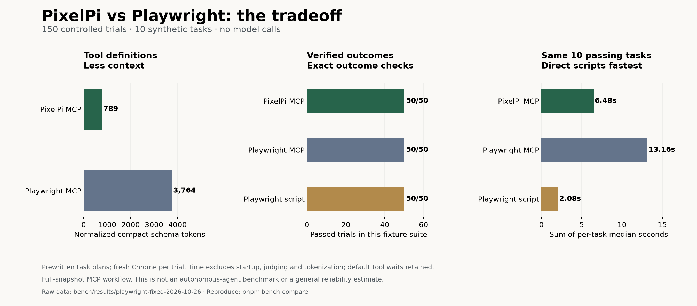

# I tested PixelPi against Playwright, fixed three failures, and ran it again

PixelPi initially passed 35 of 50 trials in a small browser-tool comparison. After fixing the failures, it passed 50 of 50. Playwright MCP and direct Playwright scripts passed all 50 in both runs.

The useful result is more specific than “PixelPi is better.” The fixed version used a smaller MCP interface and took about half the tool execution time of Playwright MCP in this workflow. Direct Playwright scripts remained substantially faster.



## What I actually tested

I compared PixelPi's six-tool MCP server, Playwright MCP 0.0.83 with 25 tools, and handwritten Playwright scripts. All used Chrome 155.0.8059.86 on the same Mac, headless, with matched viewports. The Playwright dependency was pinned to `1.64.0-alpha-1790635538000`.

Each system ran ten local workflows five times: extraction, search, a blank form, a dropdown, a checkbox, a long page, prefilled fields, a delayed button, open Shadow DOM, and an iframe. Each trial used a fresh browser. System order rotated. The grader checked the exact extracted value or event received by the fixture server; a tool claiming success was insufficient.

**No LLM made decisions.** These were prewritten plans testing browser primitives, not agents solving unfamiliar tasks. The two measured runs contain 300 trials in total. The original and fixed runs use identical task definitions, expected outcomes, and fixture source hashes. Raw data from both runs is preserved.

This investigation started with Pomerado's performance claims. Its actual task pack, graders, and environment setup were unavailable in the public materials examined. This comparison therefore cannot establish a ranking against Pomerado. The [separate vendor report](POMERADO_COMPARISON.md) records that limitation.

## The failures were concrete

| Scenario | Original PixelPi | Fixed PixelPi | Playwright MCP, rerun | Direct scripts, rerun |
|---|---:|---:|---:|---:|
| Replace prefilled values | 0/5 | 5/5 | 5/5 | 5/5 |
| Click a temporarily disabled button | 0/5 | 5/5 | 5/5 | 5/5 |
| Click inside an iframe | 0/5 | 5/5 | 5/5 | 5/5 |
| Remaining seven scenarios | 35/35 | 35/35 | 35/35 | 35/35 |
| **Total** | **35/50** | **50/50** | **50/50** | **50/50** |

The original `fill` appended text to existing values. The submitted name became `Ada LovelaceOld Name`. The fix selects and replaces the existing value through browser input, then checks the accepted value, including after the settling period. Empty values, textareas, contenteditable fields, trusted input events, and rejected controlled-input values have separate regression checks.

The delayed-button case exposed missing actionability checks. PixelPi clicked while the button was disabled and returned success without producing the expected event. Actions now wait for visible, enabled, stable targets and check whether the target receives pointer events. Covered or permanently disabled targets produce bounded errors. Playwright's [documented actionability checks](https://playwright.dev/docs/actionability) already provided this kind of waiting.

The iframe button was missing from PixelPi's snapshot. The fix walks frame accessibility trees, routes commands to the correct renderer session, and translates pointer coordinates through enclosing frames. The comparison uses a same-origin iframe; separate Chrome regressions cover nested, cross-origin, and replaced frames.

The original run had ten silent failures: its tools reported no error, but the independent outcome check failed. The fixed run had zero.

## Smaller context, with a defined accounting method

| Normalized tool definitions | Tools | Tokens |
|---|---:|---:|
| Fixed PixelPi | 6 | 789 |
| Playwright MCP | 25 | 3,764 |

PixelPi used **4.77× fewer definition tokens**. These counts use `o200k_base` and compact JSON containing only `name`, `description`, and `inputSchema`. Complete pretty-printed definitions contain 1,195 versus 6,551 tokens. Six tools and 25 tools do not imply equal capability.

Across all ten passing workflows, the sums of per-task median response-token counts were **6,393 for PixelPi and 17,296 for Playwright MCP**, a 2.71× difference. The long-page task contributes heavily; the mean of the ten individual task ratios is 2.57×. Argument tokens are recorded separately.

The controller used a full-snapshot workflow. This Playwright MCP release often returns snapshot file links after actions, so the controller called `browser_snapshot` to read the content. Those calls were charged. PixelPi's inline snapshots and pagination were also charged. Reading selected file lines or using scoped snapshots could change the result.

These are text-size measurements, not API bills. Model reasoning, conversation history, caching, and tool-selection behavior were not measured. Direct scripts used no model context.

## Tool execution time

All ten tasks passed in the rerun, so all ten enter the timing comparison:

| System | Sum of ten per-task median times |
|---|---:|
| Fixed PixelPi MCP | **6.48 seconds** |
| Playwright MCP | **13.16 seconds** |
| Direct Playwright scripts | **2.08 seconds** |

PixelPi was **2.03× faster than Playwright MCP** under this protocol. Direct scripts were **3.12× faster than PixelPi**. These sums combine separate task medians; they are not one recorded end-to-end session. Startup, warmup, tokenization, and judging are excluded. Tool transport, reference resolution, and default action waits are included.

The fixes also added overhead. On the original seven shared successful tasks, PixelPi's summed medians rose from 3.15 to 3.94 seconds between runs. Waiting and verification do work that an unchecked click does not. This before/after observation is not a controlled attribution of every timing difference.

A model's latency and number of reasoning turns could dominate these differences in an actual assistant. The measurements here establish tool behavior, not autonomous-agent speed or dollar cost.

## Fixing false success beyond the benchmark

A separate Chrome probe showed replay returning `ok: true` after an extraction threw an error. Replay now checks every tool result and stops on errors. It returns the current designated output and keeps saved prose separately as `recordedFinalText`.

Traces can declare assertions comparing fresh page evaluations with expected values. `verified: true` requires passing assertions; `ok: true` alone indicates successful execution and any declared checks. Required outputs fail when missing. Repaired traces are saved only after the complete replay and its checks succeed.

Tab creation and switching now change the driven session, and recorded tab references can be mapped to fresh targets during replay. MCP screenshots include PNG image blocks. Cancellation interrupts active operations and prevents cancelled queued calls from running. CDP commands and tool execution have deadlines; host evaluation runs in a terminable worker.

Validation passed: **274 unit tests, 17 real-browser test entries, and 8 benchmark-harness tests**, plus builds, typechecks, and package validation. CI now runs browser regressions and a comparison acceptance gate that exits nonzero for any failed outcome.

The legacy navigation-only replay probe expected a fresh heading despite recording no extraction. Its updated regression explicitly checks that no fresh output or verified outcome is claimed, and that recorded prose stays separate. A further case requires output and confirms failure when absent. This diagnostic clarification does not change the ten-task comparison or its graders.

## Is it better, and is it ready?

For a compact browser interface delivered to an agent, these results support PixelPi's context advantage and lower tool latency against the tested full-snapshot Playwright MCP workflow. The fixes close the three observed coverage gaps in this suite.

For a known workflow that can be scripted, direct Playwright remains the stronger performance baseline here. It also has a broader automation interface. Avoiding a model call at every step is possible with either a PixelPi trace or a saved Playwright script.

**Passing this suite is not proof of 100% readiness across websites.** It does not cover authenticated enterprise applications, CAPTCHAs, downloads, uploads, mobile browsers, arbitrary visual interactions, or every frame layout. The model-backed solve and healing paths were not live-tested because no working API key was available. End-to-end agent reliability and Pomerado's comparative claims remain unmeasured.

The next meaningful evaluation puts the same model behind both MCP servers, uses unfamiliar tasks on resettable realistic applications, declares a repair budget, and grades the final state independently. Until then, the defensible claim is: PixelPi passes these tested workflows with less MCP context and lower tool latency than this Playwright MCP workflow; direct scripts remain faster.

## Reproduce and inspect

```sh
pnpm install --frozen-lockfile
pnpm build
pnpm test
pnpm test:bench
pnpm test:browser
pnpm bench:compare --repeats 5 --out bench/results/my-comparison --require-all-pass
python3 bench/comparison/summarize.py bench/results/my-comparison
```

Requires Node, pnpm, and local Google Chrome; no model key is needed. Use a new output directory. Add `--chart` to the summary command in a Python environment with Matplotlib.

- [Protocol, runner, fixtures, and limitations](comparison/README.md)
- [Original 150 trials](results/playwright-2026-10-26/trials.jsonl) and [summary](results/playwright-2026-10-26/summary.json)
- [Fixed 150 trials](results/playwright-fixed-2026-10-26/trials.jsonl), [per-task tables](results/playwright-fixed-2026-10-26/tables.md), and [summary](results/playwright-fixed-2026-10-26/summary.json)
- [Fixed revision and source hashes](results/playwright-fixed-2026-10-26/manifest.json), [environment](results/playwright-fixed-2026-10-26/environment.json), and [replay diagnostics](results/playwright-fixed-2026-10-26/replay-probe.json)
- [Chart PNG](results/playwright-fixed-2026-10-26/comparison.png) and [SVG](results/playwright-fixed-2026-10-26/comparison.svg)

Measured October 26, 2026. Original implementation: `2579d55`. Fixed implementation: `638067c`. Excluded pilot runs debugged the controller and checked fixes before the measured runs. Production code was held fixed throughout each five-repetition run.
