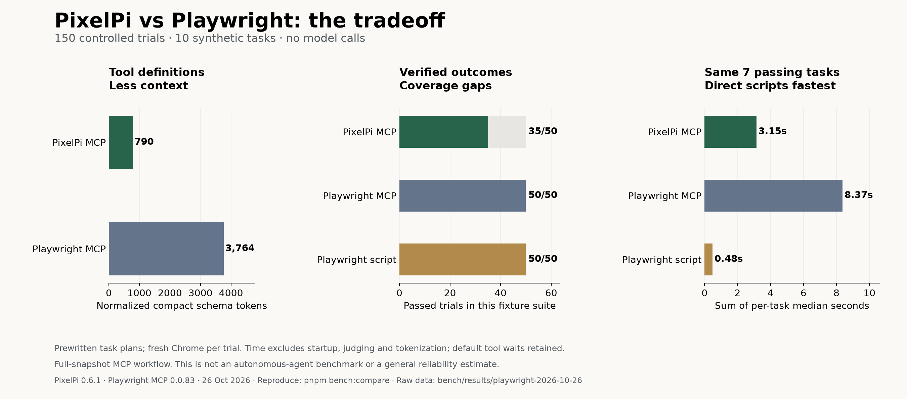

# PixelPi vs Playwright: what a smaller browser toolset buys you

I ran 150 controlled browser trials to find out whether PixelPi is actually better than Playwright.

The answer depends on the job. PixelPi used less context and completed the shared successful workflows faster than Playwright MCP. Playwright handled more of the test cases. Ordinary Playwright scripts were substantially faster than either MCP path.

That makes PixelPi's strongest demonstrated advantage a smaller interface for an agent. These results do not establish that it is a better general-purpose browser automation system.



## Three systems, with different jobs

Comparing PixelPi with “Playwright” without specifying the interface is misleading. I tested three paths:

| System | How the browser is driven |
|---|---|
| PixelPi 0.6.1 | Six tools exposed through its actual MCP server |
| Playwright MCP 0.0.83 | The default set of 25 tools through its actual MCP server |
| Playwright scripts | Handwritten code using role locators, fill, click, select, and frame locators |

All three used the same installed Chrome version, 155.0.8059.86. The direct-script baseline used the Playwright version bundled with the pinned MCP release: `1.64.0-alpha-1790635538000`. These were headless runs on one Mac, with the viewport matched across systems.

The test controller followed fixed instructions. **No LLM made decisions.** That removes model variability and lets us inspect browser-tool behavior, but it also limits the claim: this is not a benchmark of autonomous agents solving unfamiliar tasks.

## Ten workflows, five repetitions each

I used a small local website with known state. Six scenarios cover basic operations: reading an invoice reference, searching and opening a result, filling a blank form, selecting a dropdown, checking a checkbox, and finding the last button on a long page. Four stress cases cover replacing prefilled values, a temporarily disabled button, open Shadow DOM, and an iframe.

Each trial started with a fresh browser. System order rotated across tasks and repetitions. Browser startup and warmup were recorded separately from task execution. The controller did not try alternative strategies after a failure.

The grader checked the extracted value or the exact event received by the local server. A successful tool response alone could not pass a task. Submitting the wrong field values, sending nothing, or submitting twice all failed.

This last detail matters: ten PixelPi trials returned without a tool error even though the intended outcome had not happened.

## Correctness: Playwright covered more cases

| Workflow | PixelPi | Playwright MCP | Playwright scripts |
|---|---:|---:|---:|
| Read invoice reference | 5/5 | 5/5 | 5/5 |
| Search and open details | 5/5 | 5/5 | 5/5 |
| Fill a blank form | 5/5 | 5/5 | 5/5 |
| Select a dropdown | 5/5 | 5/5 | 5/5 |
| Toggle a checkbox | 5/5 | 5/5 | 5/5 |
| Find button 240 on a long page | 5/5 | 5/5 | 5/5 |
| Replace prefilled form values | 0/5 | 5/5 | 5/5 |
| Click a temporarily disabled button | 0/5 | 5/5 | 5/5 |
| Click inside open Shadow DOM | 5/5 | 5/5 | 5/5 |
| Click inside a same-origin iframe | 0/5 | 5/5 | 5/5 |
| **Total** | **35/50** | **50/50** | **50/50** |

All three passed the six basic scenarios. PixelPi's three failing scenarios reproduced in every repetition:

- **Prefilled fields:** `fill` inserted the new text without replacing the old value. The submitted name was `Ada LovelaceOld Name`, rather than `Ada Lovelace`. The tool returned without an error.
- **Delayed action:** the controller clicked Prepare, then Launch. Launch became enabled after 900 milliseconds. PixelPi dispatched its click while the button was disabled, returned without an error, and never produced the launch event. Playwright completed the action.
- **Iframe:** the button inside the same-origin iframe was absent from PixelPi's default accessibility snapshot. The controller could not resolve a reference to click it. Playwright MCP exposed the frame reference; the direct script used a frame locator.

Playwright documents [actionability checks and automatic waiting](https://playwright.dev/docs/actionability), including waiting for a click target to become enabled. That behavior helps explain the delayed-button result.

These are intentionally selected diagnostic cases, not a representative sample of websites. **35/50 is a fixture result, not a claim that PixelPi has 70% real-world reliability.** An agent could add a clearing step, explicitly wait, or write an `eval` workaround. A model's thinking time might also outlast the button's delay. Those adaptations were not tested here.

## Context: PixelPi's advantage is real, with a scope

I counted text with `o200k_base`. To compare tool definitions consistently, I retained `name`, `description`, and `inputSchema`, removed MCP annotations, and serialized both lists as compact JSON.

| Normalized tool definitions | Tools | Tokens |
|---|---:|---:|
| PixelPi | 6 | 790 |
| Playwright MCP | 25 | 3,764 |

That is **4.76× fewer definition tokens** for PixelPi. Part of the difference is the smaller feature set: six tools and 25 tools are not identical capability delivered in different packaging.

Serialization also changes the headline. Counting the complete, pretty-printed MCP tool lists gives 1,196 versus 6,551 tokens, or 5.48×. I use the normalized compact comparison here to reduce that presentation effect. Raw definitions and both counts are included with the results.

For tool responses, I compared only the seven workflows that all systems completed in all repetitions:

| Workflow | PixelPi response tokens | Playwright MCP response tokens |
|---|---:|---:|
| Read invoice reference | 83 | 241 |
| Search and open details | 346 | 691 |
| Blank form | 421 | 640 |
| Dropdown | 285 | 668 |
| Checkbox | 203 | 642 |
| Long page | 4,138 | 12,351 |
| Shadow DOM | 124 | 365 |
| **Sum of per-task medians** | **5,600** | **15,598** |

PixelPi used **2.79× fewer response tokens** on this shared workload. The long page contributes most of that total; giving every workflow equal weight produces a mean per-task ratio of 2.55×. Tool-argument tokens are recorded separately and excluded from this table.

There is a workflow choice behind these numbers. This Playwright MCP release returns links to snapshot files after many actions. The controller requested the full content using `browser_snapshot`, and charged for that call and its response. PixelPi's inline snapshots and any required pagination were also fully counted. An agent that reads only selected parts of snapshot files, scopes snapshots, or uses selectors directly could have a different result.

These are text-size measurements, not API bills. They do not include reasoning tokens, repeated conversation history, caching, or a model's choice of tools. Direct Playwright scripts had no model-context cost in this test.

## Speed: faster than the MCP baseline, slower than scripts

Failing quickly is not a speed advantage. The timing comparison therefore uses the same seven workflows completed by all three systems.

| System | Sum of the seven per-task median times |
|---|---:|
| PixelPi MCP | **3.15 seconds** |
| Playwright MCP | **8.37 seconds** |
| Playwright scripts | **0.48 seconds** |

PixelPi took **2.66× less time than Playwright MCP** on that workload. Direct Playwright scripts took **6.53× less time than PixelPi**.

Those numbers sum seven separate per-task medians; they are not a single recorded end-to-end session. Timing includes navigation, tool transport, and reference resolution. Startup, warmup, token counting, and the independent grader are excluded. Per-task medians and ranges are in the [summary data](results/playwright-2026-10-26/summary.json).

Default waiting behavior was retained. PixelPi waits for a quiet DOM after actions; Playwright MCP has its own settling behavior and automatic waits. That affects the observed gap. In a real agent loop, model latency and the number of model turns could matter more than these browser-tool times.

Ordinary scripts are an essential baseline here. Deterministic browser automation does not inherently need a model call at each step. PixelPi's recorded replay is useful, but avoiding repeated inference is also possible with a saved Playwright script.

## Is PixelPi better?

For an agent that needs a compact browser interface, **the context advantage is supported by measurements**. It also completed these shared workflows with lower tool latency than the full-snapshot Playwright MCP path.

For a known workflow that can be scripted, **I would choose ordinary Playwright today**. It was faster on the shared workload and completed every scenario in this suite. For broader browser interactions, Playwright MCP also handled cases that PixelPi's default tools missed.

Before making a broader claim for PixelPi, I would prioritize replacing existing field values correctly, checking actionability before clicks, and supporting frame traversal. I would also fix the separate [replay error-propagation issue](POMERADO_COMPARISON.md): an earlier real-browser probe returned `ok: true` when extraction had thrown an error. That probe is not part of the 150 trials reported here.

The next evaluation should put the same model behind both MCP servers, use unfamiliar tasks and realistic resettable applications, allow a declared repair budget, and grade the final state independently. That is the test needed to say whether the smaller interface helps an agent succeed more often or spend less money.

For now, the supported claim is narrower: **PixelPi offers a smaller MCP interface with lower overhead on these shared workflows, while Playwright provides stronger coverage in this test suite.**

## Reproduce the results

The benchmark needs Node, pnpm, and local Google Chrome. No model API key is required.

```sh
pnpm install --frozen-lockfile
pnpm build
pnpm bench:compare --repeats 5 --out bench/results/my-comparison
python3 bench/comparison/summarize.py bench/results/my-comparison
```

Use a new output directory: the runner refuses to overwrite existing trials. To regenerate the chart, install Matplotlib in a Python environment and pass `--chart` to the summary script.

- [Protocol and limitations](comparison/README.md)
- [Runner](comparison/run.ts) and [fixtures](comparison/fixture.ts)
- [Every trial and tool transcript](results/playwright-2026-10-26/trials.jsonl)
- [Source hashes, task definitions, and versions](results/playwright-2026-10-26/manifest.json)
- [Measured environment and definition counts](results/playwright-2026-10-26/environment.json)
- [Summary](results/playwright-2026-10-26/summary.json), [PNG chart](results/playwright-2026-10-26/comparison.png), and [SVG chart](results/playwright-2026-10-26/comparison.svg)

Measured October 26, 2026, against PixelPi commit `2579d5563180f3d18eb4bebe5b6631439b583a65`. Benchmark tooling was added in the working tree; its measured source hashes are recorded in the manifest. PixelPi's production implementation was unchanged. Excluded pilot runs were used to debug the test controller before the five-repetition measurement run.
